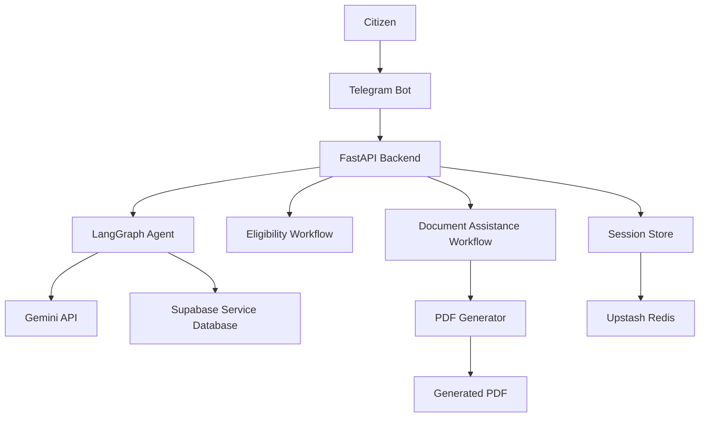

# CivicBridge Backend

### AI-Powered Citizen-Centric Government Services Assistant

CivicBridge is an AI-powered government services assistant designed to simplify access to public services by helping citizens discover relevant schemes and services, understand application requirements, check eligibility, and receive step-by-step guidance through a conversational interface.

The project aims to make government service information more accessible and understandable by combining Large Language Models (LLMs), backend APIs, structured service data, session management, and automated document generation.

**Current focus:** Backend development, AI-powered service discovery, Telegram-based interaction, eligibility assistance, document assistance, and PDF generation.

---

## Table of Contents

- [Project Overview](#project-overview)
- [Problem Statement](#problem-statement)
- [Project Objectives](#project-objectives)
- [Key Features](#key-features)
- [Technology Stack](#technology-stack)
- [System Architecture](#system-architecture)
- [Project Structure](#project-structure)
- [Backend API Endpoints](#backend-api-endpoints)
- [Core Components](#core-components)
- [Database Design](#database-design)
- [Environment Configuration](#environment-configuration)
- [Installation and Setup](#installation-and-setup)
- [Running the Application](#running-the-application)
- [Testing](#testing)
- [Security and Reliability](#security-and-reliability)
- [Current Limitations](#current-limitations)
- [Future Enhancements](#future-enhancements)
- [Project Status](#project-status)

---

## Project Overview

Navigating government services can be challenging because information is distributed across multiple official portals, eligibility conditions vary by service and jurisdiction, and application procedures often require several documents and steps.

CivicBridge aims to provide a unified conversational interface through which users can:

- Discover government services using natural-language queries.
- Retrieve relevant service information from a structured database.
- Understand eligibility conditions and application requirements.
- Receive document assistance through guided questions.
- Generate PDFs containing the information collected during a document workflow.
- Interact with the assistant through a Telegram bot.

The backend serves as the core processing layer, connecting the conversational interface, AI agent, database, session storage, and document-generation components.

## Problem Statement

Citizens often need to navigate multiple government websites to find accurate information about eligibility, required documents, and application procedures. The information may be difficult to understand, and users may not know which service is appropriate for their needs.

CivicBridge addresses this problem by providing an AI-assisted interface that organizes service information and guides users through relevant workflows.

The project is designed to complement official government portals, not replace them. Applications, approvals, and other official decisions remain subject to the relevant government department's processes.

## Project Objectives

1. **Simplify service discovery:** Identify relevant government services from natural-language requests.
2. **Improve accessibility:** Present complex procedures in clear, conversational language.
3. **Support eligibility assessment:** Compare user-provided information against available eligibility criteria.
4. **Assist with documentation:** Collect and validate information required for supported document workflows.
5. **Automate PDF generation:** Generate downloadable PDF documents from collected information.
6. **Maintain conversational state:** Preserve temporary user-session information across multi-step interactions.
7. **Provide modular architecture:** Separate the API, AI agent, document workflows, session storage, and database operations.

## Key Features

### 1. AI-Powered Service Discovery

The backend uses Google's Gemini API to interpret user queries and identify potentially relevant government services.

The agent workflow includes service identification, validation, database retrieval, and response generation.

### 2. Government Service Database

Supabase is used as the database layer for storing and retrieving structured government service information.

The initial service scope includes:

- Driving Licence
- Vehicle Registration
- Passport
- Voter ID
- PAN
- Birth Certificate
- Income Certificate
- Caste Certificate

The availability and completeness of information may vary by service and jurisdiction.

### 3. LangGraph-Based Agent Workflow

LangGraph is used to organize the AI service-discovery workflow into distinct processing stages.

This modular design makes it easier to maintain the workflow, validate service identification, retrieve relevant data, and generate responses.

### 4. Telegram Bot Integration

The Telegram bot provides a conversational interface for interacting with the backend.

It supports message handling and guided workflows for supported eligibility and document-assistance requests.

### 5. Eligibility Assistance

The eligibility workflow collects relevant information from users and evaluates it against the criteria available for the selected service.

Results are intended as preliminary guidance. They do not constitute an official eligibility determination or guarantee approval.

### 6. Document Assistance

The document-assistance component supports guided, multi-step collection of information required for supported document workflows.

It includes functionality for retrieving workflow details, asking questions, recording answers, validating responses, and preparing document data.

### 7. PDF Generation

The PDF-generation component creates PDF files from structured document data collected during the supported workflow.

Generated PDFs are intended to assist users with document preparation. They are not automatically equivalent to official government-issued certificates or submitted applications.

### 8. Session Management with Redis

Redis-compatible session storage is used to maintain temporary user state during multi-step interactions.

The session layer provides operations to retrieve, save, and clear session data. The current configuration uses Upstash Redis REST credentials.

### 9. REST API

FastAPI exposes endpoints for health checks, retrieving government service records, and processing chat requests.

### 10. Modular Testing

Separate test files are included for the agent, document workflow, PDF generation, Redis, session management, and Supabase integration.

---

## Technology Stack

| Technology | Purpose |
|---|---|
| Python | Primary programming language |
| FastAPI | REST API and backend application |
| Google Gemini API | Natural-language understanding and response generation |
| LangGraph | AI agent workflow orchestration |
| Supabase | Structured service data and database access |
| Redis / Upstash Redis | Temporary session storage |
| Telegram Bot API | Conversational user interface |
| ReportLab | PDF document generation |
| Uvicorn | ASGI server for running FastAPI |
| Pytest | Testing framework, where configured |

---

## System Architecture

The backend follows a modular architecture in which the conversational interface communicates with backend components responsible for AI processing, database access, session management, and document generation.



### Architecture Components

- **Telegram Bot:** Receives user messages and manages conversational interactions.
- **FastAPI:** Exposes HTTP endpoints and connects backend functionality.
- **LangGraph Agent:** Coordinates the service-discovery workflow.
- **Gemini API:** Interprets natural-language queries and generates responses.
- **Supabase:** Stores and retrieves structured government service information.
- **Eligibility Workflow:** Collects user information and evaluates available criteria.
- **Document Workflow:** Manages document-related questions and user responses.
- **PDF Generator:** Produces PDFs from prepared document data.
- **Redis Session Store:** Stores temporary state required for multi-step interactions.

---

## Project Structure

The current backend codebase is organized into the following components:

```text
CivicBridge-Backend/
│
├── agent.py
├── main.py
├── telegram_bot.py
├── document_agent.py
├── pdf_generator.py
├── redis_client.py
├── session_store.py
├── load_services.py
│
├── check_models.py
│
├── test_agent.py
├── test_document_agent.py
├── test_pdf_generator.py
├── test_redis.py
├── test_session.py
├── test_supabase.py
│
├── .env.example
├── .gitignore
├── requirements.txt
└── README.md
```

*Note: The documentation and dependency files should be added to the repository if they are not present yet. Keep only files that actually exist in your final repository.*

### File Responsibilities

| File | Responsibility |
|---|---|
| `main.py` | FastAPI application and REST API endpoints |
| `agent.py` | AI agent, service discovery, service retrieval, and eligibility-related logic |
| `telegram_bot.py` | Telegram commands, messages, and guided conversational workflows |
| `document_agent.py` | Document workflow, question handling, answer validation, and data preparation |
| `pdf_generator.py` | PDF generation from structured document data |
| `redis_client.py` | Redis-compatible connection configuration |
| `session_store.py` | Session retrieval, saving, and clearing |
| `load_services.py` | Loading service records into Supabase |
| `check_models.py` | Checking available Gemini models |
| `test_agent.py` | Agent-related tests |
| `test_document_agent.py` | Document workflow tests |
| `test_pdf_generator.py` | PDF-generation tests |
| `test_redis.py` | Redis connectivity tests |
| `test_session.py` | Session management tests |
| `test_supabase.py` | Supabase connectivity and query tests |

---

## Backend API Endpoints

The current FastAPI application exposes the following core endpoints.

| Method | Endpoint | Description |
|---|---|---|
| `GET` | `/` | Returns a backend status message |
| `GET` | `/services` | Retrieves service records from Supabase |
| `GET` | `/services/{service_id}` | Retrieves a specific service using its identifier |
| `POST` | `/chat` | Processes a chat request using the AI service-discovery functionality |

### 1. Backend Health Check

**Request**

```http
GET /
```

**Example response**

```json
{
  "message": "CivicBridge backend is running"
}
```

### 2. Retrieve All Services

**Request**

```http
GET /services
```

Returns the service records retrieved from the Supabase `services` table.

### 3. Retrieve a Specific Service

**Request**

```http
GET /services/{service_id}
```

Retrieves a service using its identifier.

### 4. Chat Endpoint

**Request**

```http
POST /chat
Content-Type: application/json
```

Example request body, subject to the request model defined in `main.py`:

```json
{
  "message": "I want to apply for an Income Certificate"
}
```

The endpoint processes the user query through the configured chat and service-discovery logic.

**Note:** Confirm the request schema and response format in the current `main.py` before publishing API examples as final documentation.

Interactive API documentation can be accessed at `/docs` while the FastAPI server is running.

---

## Core Components

### AI Agent and Service Discovery

The agent identifies the service relevant to a user's request, validates the identification, retrieves the associated database record, and generates a response.

The workflow is designed to reduce irrelevant responses by using structured service data alongside the language model.

### Eligibility Workflow

The eligibility functionality uses available service criteria and user-provided information to support a preliminary assessment.

Its reliability depends on the completeness, accuracy, and jurisdictional relevance of the configured service data.

### Document Workflow

The document-assistance module manages a sequence of questions and answers. It supports starting a workflow, retrieving the next question, saving responses, validating answers, and preparing the resulting document data.

### PDF Generation

The PDF generator converts prepared document information into a PDF file. The generated document should be reviewed by the user and must not be represented as an official certificate unless issued by the authorized government department.

### Session Management

The session store provides functions to get, save, and clear session information. This allows supported conversational workflows to retain temporary state between user interactions.

---

## Database Design

Supabase provides the structured database layer.

### Services Table

The backend uses a table named `services` to retrieve and store government service information.

Depending on the records configured in the database, service information can include details such as:

- Service identifier and name
- Description
- Eligibility criteria
- Required documents
- Application procedure
- Relevant official links
- Jurisdiction-specific information

The exact columns and data types depend on the existing Supabase schema.

### Why Supabase?

- Managed PostgreSQL database.
- Structured storage and querying.
- Convenient integration with Python.
- Suitable for maintaining service records independently of the AI workflow.

### Why Redis?

Redis is used for temporary session state rather than as the primary database for government service information.

This separates persistent service records from short-lived conversational data.

---

## Environment Configuration

The backend uses environment variables to configure external services.

Create a local `.env` file in the location from which the application loads its environment configuration.

Example:

```env
SUPABASE_URL=your_supabase_project_url
SUPABASE_KEY=your_supabase_key

GEMINI_API_KEY=your_gemini_api_key

TELEGRAM_BOT_TOKEN=your_telegram_bot_token

UPSTASH_REDIS_REST_URL=your_upstash_redis_rest_url
UPSTASH_REDIS_REST_TOKEN=your_upstash_redis_rest_token
```

Replace the example values with your own credentials.

**Security requirements:**

- Never commit `.env` to GitHub.
- Do not put API keys or tokens in source code, screenshots, or README examples.
- Add `.env` to `.gitignore`.
- If a credential is accidentally published, revoke or rotate it.
- Use environment variables or an appropriate secrets manager for deployment.

The `.env.example` file may be committed with placeholder values only.

---

## Installation and Setup

### Prerequisites

Before running the backend, ensure that you have:

- Python installed.
- A Supabase project with the required `services` table.
- A Gemini API key.
- A Telegram bot token if you want to run the Telegram interface.
- Upstash Redis credentials if you want to use Redis-backed session management.

### 1. Clone the Repository

```bash
git clone https://github.com/YOUR_USERNAME/CivicBridge-Backend.git
cd CivicBridge-Backend
```

### 2. Create a Virtual Environment

```bash
python -m venv venv
```

Activate it on Windows:

```bash
venv\Scripts\activate
```

### 3. Install Dependencies

Install the packages listed in `requirements.txt`:

```bash
python -m pip install -r requirements.txt
```

Ensure that `requirements.txt` contains the dependencies required by the actual codebase.

### 4. Configure Environment Variables

Create the `.env` file and populate the required variables using your own credentials.

### 5. Configure the Database

Ensure that the Supabase `services` table exists and contains the service records required by the application.

Use `load_services.py` only after verifying the expected data and database schema to avoid inserting duplicate records.

---

## Running the Application

### Start the FastAPI Backend

From the directory containing `main.py`, run:

```bash
uvicorn main:app --reload
```

If `main.py` is inside a `backend` package and you are running the command from the project root, use the appropriate module path:

```bash
uvicorn backend.main:app --reload
```

The correct command depends on the actual location of the file and the project's import structure.

### Open API Documentation

Once the server starts, visit:

```text
http://127.0.0.1:8000/docs
```

Use the Swagger UI to inspect and test the available endpoints.

### Run the Telegram Bot

Configure the Telegram bot token and the other required environment variables. Then run the bot using the correct module path and working directory for the project's imports.

For example, from the project root:

```bash
python -m backend.telegram_bot
```

The bot and FastAPI server may need to run in separate terminal sessions.

---

## Testing

The repository includes separate test files for key backend components.

| Test file | Area |
|---|---|
| `test_agent.py` | Agent behavior |
| `test_document_agent.py` | Document workflows |
| `test_pdf_generator.py` | PDF generation |
| `test_redis.py` | Redis connectivity |
| `test_session.py` | Session management |
| `test_supabase.py` | Database integration |

If Pytest is configured and installed, run the tests from the project root:

```bash
python -m pytest
```

Some integration tests may require valid external credentials, database records, and a reachable Redis service.

Tests should be run and their results reviewed before describing a feature as fully verified.

---

## Security and Reliability

CivicBridge is intended to assist users in navigating government services. Accuracy, privacy, and transparency are therefore important design considerations.

- **Official sources:** Use official government portals to verify application rules, fees, eligibility, and submission procedures.
- **Data protection:** Avoid collecting unnecessary personal information and do not publish user data or generated documents.
- **Credential security:** Store external service credentials outside the source code.
- **Eligibility transparency:** Present eligibility assessments as guidance rather than official decisions.
- **Document accuracy:** Allow users to review collected information before generating documents.
- **Error handling:** Validate inputs and handle failures from external APIs and database services.
- **Testing:** Test service discovery, session handling, document generation, and database interactions independently.

---

## Current Limitations

The project is under active development. The current backend should not be considered a complete government application-submission platform.

- Service information may not cover every state, union territory, or department.
- Government APIs may not be available for every service.
- Eligibility guidance depends on the criteria stored in the database.
- PDF generation does not itself submit applications or issue official certificates.
- Application tracking depends on the availability of authorized APIs or official tracking portals.
- External API availability, rate limits, and credentials can affect functionality.
- Features may require additional end-to-end testing before deployment.

---

## Future Enhancements

Planned improvements include:

1. Expand service coverage and maintain verified, jurisdiction-specific information.
2. Improve conversational eligibility checks and validation.
3. Enhance document workflows and user confirmation steps.
4. Provide official application links and tracking guidance where available.
5. Integrate authorized government APIs when access is available.
6. Add stronger automated testing and end-to-end validation.
7. Improve logging, monitoring, and error recovery.
8. Deploy the backend using a secure, production-ready configuration.
9. Develop a web-based interface alongside the Telegram bot if required.
10. Improve privacy controls and handling of generated documents.

---

## Project Status

**Status: In Progress**

The current repository documents the CivicBridge backend implementation, including the FastAPI application, AI agent, service database integration, Telegram bot, session management, document assistance, and PDF-generation components.

Development and testing are ongoing. Additional features, validation, and deployment work will be completed incrementally.

---

## Disclaimer

CivicBridge is an independent project intended to improve access to government service information. It is not an official government platform and is not affiliated with any government department unless explicitly stated.

Users should verify requirements and submit applications through the relevant official government portals.

---

*Built as a citizen-centric AI project to make government service information easier to understand and access.*
